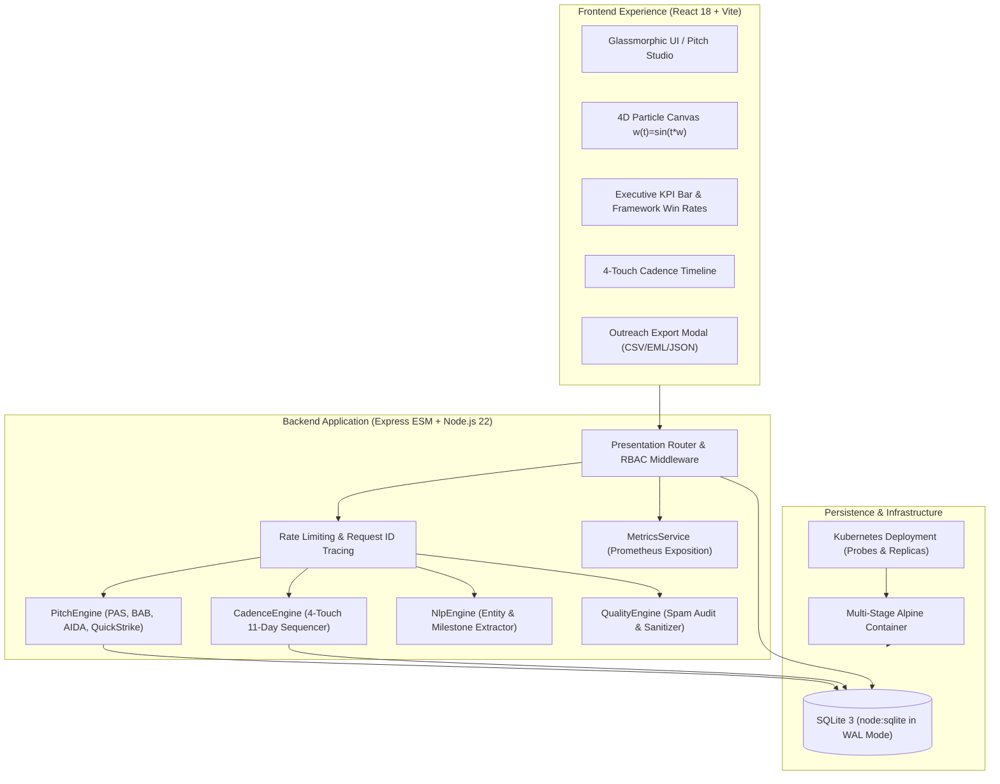

# PitchCraft AI — Enterprise AI Sales Pitch Customizer & Cadence Engine

A production-grade, enterprise B2B marketing automation platform that analyzes enterprise client trigger events (press releases, funding rounds, executive hires, product launches, expansions) and synthesizes hyper-personalized cold outreach pitches and 4-touch omnichannel cadences with real-time spam scoring, Flesch-Kincaid readability metrics, predictive engagement analytics, and multi-format CRM exports.

---

## 🌟 Executive Summary & Key Capabilities

- **Account-Based Trigger Event Personalization**: Scans enterprise milestones and extracts critical business catalysts ($M funding, % YoY growth, executive appointments, M&A acquisitions, market expansions).
- **Multi-Framework Copy Generation**: Synthesizes cold emails across 4 battle-tested copywriting frameworks:
  - **PAS**: Problem $\rightarrow$ Agitate $\rightarrow$ Solve (ideal for Engineering & DevOps leads)
  - **BAB**: Before $\rightarrow$ After $\rightarrow$ Bridge (ideal for VPs & C-Level Executives)
  - **AIDA**: Attention $\rightarrow$ Interest $\rightarrow$ Desire $\rightarrow$ Action (ideal for Directors & RevOps)
  - **QuickStrike**: 3-Sentence high-velocity mobile outreach (<70 words)
- **4-Touch Omnichannel Cadence Sequence**: Generates progressive 11-day multi-channel outreach campaigns:
  - *Touch 1 (Day 1)*: The Catalyst Hook (initial trigger & problem anchor)
  - *Touch 2 (Day 3)*: The Tactical Value Asset (benchmark calculation & peer blueprint)
  - *Touch 3 (Day 7)*: Peer Social Proof & Empirical Case Study
  - *Touch 4 (Day 11)*: Low-Pressure Graceful Exit ("Breakup" closing note)
- **Deliverability & Spam Inspector**: Algorithmic spam risk scoring (0–100), trigger phrase detection, and Flesch-Kincaid reading grade analysis.
- **Consultative Auto-Sanitizer**: One-click replacement of aggressive sales jargon with consultative value phrasing, updating deliverability telemetry in real time.
- **Predictive Engagement Scoring**: Heuristically models Open Rate %, Reply Rate %, and Call-To-Action (CTA) friction level.
- **Multi-Format Outreach Export**: Direct export to RFC 4180 CSV (Outreach, Salesloft, Apollo), RFC 822 `.eml` email files, Gmail/Outlook formatted clipboard, and JSON manifests.
- **4D-Inspired Intent Signal Telemetry Canvas**: Mathematical $4D \rightarrow 3D \rightarrow 2D$ spatial particle system evolving over time ($w(t) = \sin(t \cdot \omega)$) with pointer proximity interaction and `prefers-reduced-motion` compliance.
- **Enterprise RBAC**: Role-based access control with live persona switching between SDR Rep (`sdr_rep`), Sales Manager (`sales_manager`), and Administrator (`admin`).
- **Production Observability & SRE**: Built-in Prometheus metrics exposition (`/api/metrics`), Kubernetes liveness/readiness probes (`/api/health/live`, `/api/health/ready`), correlation IDs (`x-request-id`), and in-memory rate limiting.

---

## 🏗️ System Architecture



---

## 📁 Repository Structure

```
ai-sales-pitch-customizer/
├── .github/
│   └── workflows/
│       └── ci.yml                     # Multi-matrix CI pipeline (Node 20/22 + Docker check)
├── backend/
│   ├── src/
│   │   ├── config/constants.js        # Frameworks, spam keywords, roles, tokens
│   │   ├── data/
│   │   │   ├── database.js            # SQLite3 via native node:sqlite (WAL mode)
│   │   │   ├── seedData.js            # Seed enterprise accounts, triggers & products
│   │   │   └── repository.js          # SQLite transaction and query layer
│   │   ├── service/
│   │   │   ├── nlpEngine.js           # Entity extraction & trigger categorization
│   │   │   ├── pitchEngine.js         # Multi-framework 3-variant synthesis
│   │   │   ├── cadenceEngine.js       # 4-touch progressive cadence sequencer
│   │   │   ├── qualityEngine.js       # Spam scoring, sanitizer & engagement predictor
│   │   │   ├── metricsService.js      # Prometheus metrics aggregator
│   │   │   └── authService.js         # bcrypt password hashing & JWT bearer tokens
│   │   ├── presentation/
│   │   │   ├── routes.js              # REST API router with RBAC guards
│   │   │   └── rateLimiter.js         # Token-bucket sliding window rate limiter
│   │   └── server.js                  # Express ESM server with tracing & SPA hosting
│   ├── tests/                         # 40 unit & integration tests (100% pass)
│   │   ├── nlpEngine.test.js
│   │   ├── qualityEngine.test.js
│   │   ├── cadenceEngine.test.js
│   │   ├── pitchEngine.test.js
│   │   ├── auth.test.js
│   │   ├── api.test.js
│   │   └── security.test.js
│   └── package.json
├── frontend/
│   ├── src/
│   │   ├── api/client.js              # Fetch client with JWT injection & blob exports
│   │   ├── components/
│   │   │   ├── PitchParticleCanvas.jsx# 4D time-evolving intent signal canvas
│   │   │   ├── Navbar.jsx             # Floating glass nav & role switcher
│   │   │   ├── ExecutiveKpiBar.jsx    # Real-time telemetry & framework win-rates
│   │   │   ├── PitchStudio.jsx        # Flagship interactive customizer & cadence studio
│   │   │   ├── AccountExplorer.jsx    # Accounts, triggers & ad-hoc NLP analyzer
│   │   │   ├── ReviewLab.jsx          # Governance, A/B review & manager approvals
│   │   │   ├── ProductCatalog.jsx     # Value prop matrix & product manager
│   │   │   └── AuditFeed.jsx          # Security audit feed & role trace
│   │   ├── styles/index.css           # Apple-inspired dark glassmorphism design system
│   │   ├── App.jsx                    # Root application controller & keyboard shortcuts
│   │   └── main.jsx
│   ├── index.html
│   ├── vite.config.js
│   └── package.json
├── infra/
│   └── k8s/
│       ├── deployment.yaml            # Kubernetes deployment with probes & limits
│       └── service.yaml               # ClusterIP service
├── docs/
│   └── adr/
│       └── 0001-hybrid-in-memory-nlp-and-containerized-deployment.md
├── Dockerfile                         # Production multi-stage Alpine Dockerfile
├── docker-compose.yml                 # Local & production compose stack
├── .dockerignore
├── .env.example
└── README.md
```

---

## 🚀 Quickstart & Setup Instructions

### Prerequisites
- Node.js >= 22.5.0 (Node 22 includes native `node:sqlite` and `node:test`)
- npm >= 10.0.0

### Option 1: Local Development
```bash
# 1. Clone repository
git clone https://github.com/Hellthefox808/AI-SALE-PITCH--Customizer.git
cd AI-SALE-PITCH--Customizer

# 2. Start Backend API
cd backend
npm install
npm test          # Run all 40 unit and integration tests
npm run lint      # Check Standard JS linting
npm start         # Runs API on http://localhost:4000

# 3. Start Frontend UI (In separate terminal)
cd ../frontend
npm install
npm run lint      # Check Standard JS linting
npm run build     # Verify Vite production bundle
npm run dev       # Runs Vite dev server on http://localhost:5173
```
Open `http://localhost:5173` in your browser.

---

### Option 2: Docker & Docker Compose (Production-Ready)

Run the unified full-stack application as an optimized, non-root Alpine container:

```bash
docker compose up --build -d
```
The application will be live at `http://localhost:4000`.

To inspect logs or health status:
```bash
docker compose ps
docker compose logs -f
```

---

### Option 3: Kubernetes Deployment

Deploy to any Kubernetes cluster:
```bash
kubectl apply -f infra/k8s/deployment.yaml
kubectl apply -f infra/k8s/service.yaml
```

---

## 🧪 Automated Test Verification

All 40 automated tests pass natively with zero external dependencies:

```
▶ REST API End-to-End Integration Suite (249ms)
  ✔ GET /api/health returns healthy status
  ✔ GET /api/accounts lists seeded enterprise accounts
  ✔ GET /api/accounts/:id returns account detail with contacts and news
  ✔ POST /api/news-triggers/analyze extracts ad-hoc trigger data
  ✔ POST /api/pitches/generate synthesizes 3 variants for target account
  ✔ POST /api/pitches saves a draft and PATCH updates feedback & status
  ✔ GET /api/analytics/kpis returns executive metrics and time saved
  ✔ POST /api/pitches/cadence generates 4-touch outreach sequence
  ✔ POST /api/pitches/sanitize replaces spam jargon with clean language
  ✔ POST /api/pitches/export returns CSV payload with proper headers
  ✔ GET /api/health/live returns liveness probe
  ✔ GET /api/health/ready returns readiness probe with database verification
  ✔ GET /api/metrics returns Prometheus metrics in standard exposition format

▶ AuthService — Authentication, Token Lifecycle & Verification (265ms)
  ✔ authenticates valid user with correct password
  ✔ rejects invalid password
  ✔ rejects unknown user email
  ✔ generates and verifies valid token payload

▶ CadenceEngine — Multi-Touch Outreach Sequence Synthesis (4.8ms)
  ✔ synthesizes a 4-step omnichannel cadence with progressive value touches

▶ NlpEngine — Entity Extraction & Trigger Classification (5.5ms)
  ✔ extracts currency sums, percentages, and headcount milestones
  ✔ correctly classifies funding triggers
  ✔ correctly classifies leadership appointments
  ✔ correctly classifies product launches
  ✔ correctly identifies urgency sentiment in latency spikes or outages
  ✔ computes positive semantic relevance between product value and trigger

▶ PitchEngine — Multi-Framework & 3-Variant Pitch Synthesis (6.9ms)
  ✔ generates 3 distinct variants across PAS framework
  ✔ generates BAB framework with before/after/bridge contrast
  ✔ generates QuickStrike 3-sentence concise cold email

▶ QualityEngine — Deliverability, Spam & Readability Metrics (5.4ms)
  ✔ identifies clean cold emails with low baseline spam score
  ✔ detects high-risk spam keywords and flags them
  ✔ computes Flesch-Kincaid Grade Level within reasonable bounds
  ✔ accurately computes word count and reading time
  ✔ measures personalization depth ratio
  ✔ sanitizes spam trigger phrases into consultative language
  ✔ predicts open rate and reply rate metrics with friction scoring

▶ Security & RBAC Enforcement Suite (216ms)
  ✔ rejects unauthenticated requests to protected endpoints with 401
  ✔ rejects invalid or tampered bearer tokens with 401
  ✔ prevents SDR reps from approving pitches (returns 403)
  ✔ prevents SDR reps from deleting pitches (returns 403)
  ✔ prevents SDR reps from accessing audit logs (returns 403)
  ✔ allows Sales Managers to access audit logs (returns 200)

ℹ tests 40 | suites 7 | pass 40 | fail 0 | duration_ms 530ms
```

---

## 📊 Observability & SRE Endpoints

| Endpoint | Protocol | Purpose | Description |
|---|---|---|---|
| `/api/health` | HTTP GET | General Health | Returns service name, version, timestamp, uptime, and DB status |
| `/api/health/live` | HTTP GET | Kubernetes Liveness | Quick liveness check returning `{ status: 'alive' }` |
| `/api/health/ready` | HTTP GET | Kubernetes Readiness | Verifies SQLite connectivity via `SELECT 1` |
| `/api/metrics` | HTTP GET | Prometheus Exposition | Exports requests count, process uptime, memory heap, and pitch metrics |

---

## 🔒 Security & RBAC Matrix

| Endpoint | Method | SDR Rep | Sales Manager | Admin | Description |
|---|---|:---:|:---:|:---:|---|
| `/api/auth/login` | POST | Public | Public | Public | Authenticates credentials |
| `/api/auth/switch-persona` | POST | Public | Public | Public | Instant persona token issue |
| `/api/accounts` | GET | ✅ | ✅ | ✅ | List enterprise accounts |
| `/api/news-triggers` | GET | ✅ | ✅ | ✅ | List trigger events |
| `/api/news-triggers/analyze` | POST | ✅ | ✅ | ✅ | Ad-hoc NLP entity extraction |
| `/api/pitches/generate` | POST | ✅ | ✅ | ✅ | Synthesize 3 pitch variants |
| `/api/pitches/cadence` | POST | ✅ | ✅ | ✅ | Synthesize 4-touch cadence |
| `/api/pitches/sanitize` | POST | ✅ | ✅ | ✅ | Consultative copy sanitizer |
| `/api/pitches/export` | POST | ✅ | ✅ | ✅ | Export CSV, EML, or JSON |
| `/api/pitches` | POST | ✅ | ✅ | ✅ | Save draft pitch |
| `/api/pitches/:id` (Approve) | PATCH | ❌ (403) | ✅ | ✅ | Approve pitch for sending |
| `/api/pitches/:id` (Delete) | DELETE | ❌ (403) | ✅ | ✅ | Delete pitch record |
| `/api/products` (Create) | POST | ❌ (403) | ✅ | ✅ | Add new value proposition |
| `/api/audit-logs` | GET | ❌ (403) | ✅ | ✅ | Inspect security audit trail |

---

## ⌨️ Global Keyboard Shortcuts

- `1`: Jump to **Pitch Studio**
- `2`: Jump to **Accounts & News Trigger Explorer**
- `3`: Jump to **Outreach Governance & Review Lab**
- `4`: Jump to **Product & Value Proposition Matrix**
- `5`: Jump to **Security & Activity Audit Logs**
- `P`: Pause / Resume 4D Particle Telemetry
- `R`: Refresh live telemetry data from server
